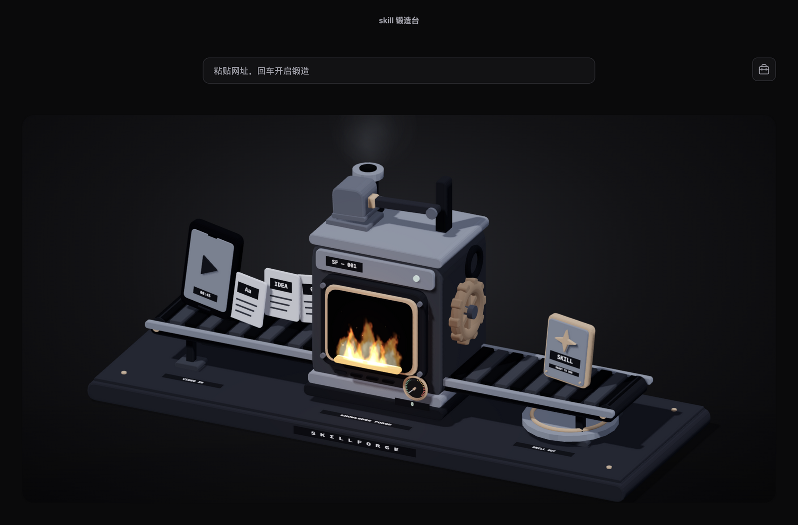

# SkillForge

A webpage-to-skill tool powered by your AI agent.<br />
One webpage. One distillation. One reusable Skill.

**English** · [简体中文](README.md)

## Introduction

SkillForge turns knowledge from a webpage into a skill your coding agent can use again.

Give Codex, Claude Code, or another compatible agent a tutorial, a document, or a how-to guide. SkillForge opens the page and reads its text; your current agent turns it into actionable instructions while a desktop 3D forge shows the task stages. The result is saved to a local toolbox and installed into your agent by default.

- **One webpage.** Start with a URL. If the page requires login or verification, complete it in a separate window. Your agent keeps waiting for the content, without asking you to copy the entire article.
- **One distillation.** Produce a purpose, trigger conditions, and steps—not just a summary. Your current agent does the analysis, so SkillForge needs no separate model endpoint or API key.
- **One reusable Skill.** Generate a standard `SKILL.md`, retain its source, and install it into Codex, Claude Code, or a custom skills directory. Existing skills are never overwritten, and a failed installation does not lose the result.



## Installation

Requires Node.js 22.12 or later. On macOS Apple Silicon, the skill entry point can install the desktop app, dependencies, and speech runtime automatically:

```sh
npx skills add funeyu/SkillForge --skill skillforge
```

The skills CLI copies the skill; it does not execute application installation hooks. After installation, ask your agent to “install and initialize SkillForge,” or use the skill for the first time. Its entry point downloads the desktop app with Electron, dependencies, speech model, and standalone speech runtime, shows download percentage/bytes and verification, extraction, and speech-check progress, then binds the runtime automatically. No manual `runtime.json` or Python installation is needed. To initialize immediately:

```sh
node "<Skill directory reported by the skills CLI>/scripts/skillforge.cjs" setup
```

The default destination is `~/Applications/SkillForge.app`; existing apps are reused. Setup reports readiness only after the speech self-check passes. See the [installation guide (Chinese)](docs/guide.zh-CN.md#安装到-agent).

The [0.0.1 release](https://github.com/funeyu/SkillForge/releases/tag/0.0.1) provides a desktop app for macOS Apple Silicon as a DMG or ZIP. It bundles the speech model and a standalone speech runtime, so Python is not required. There are no packages for Intel Macs, Windows, or Linux yet.

After moving the app to Applications, you can use its installer instead. It installs the entry point and binds the runtime path automatically. Choose one installation method; do not install twice into the same directory.

```sh
node /Applications/SkillForge.app/Contents/Resources/app/scripts/agent.cjs install-skill
```

The default target is Codex. Append `--agent claude` for Claude Code or use `--skills-dir` for a custom directory. The app is not Developer ID signed or notarized; verify the download source before following the prompts in System Settings → Privacy & Security to open it.

Reload your agent session, then ask:

> Use SkillForge to turn this webpage into a reusable Skill: webpage URL.

Your agent opens SkillForge, reads the page, and distills the content. If login is required, complete it in the reader window and click the button to reread the page; you do not need to notify the agent in chat. The desktop app does not call a model on its own—it still needs your current agent to perform the analysis.

## Commands

Your agent runs these commands, but you can also run them from the source directory. An installed skill uses `node "<skill directory>/scripts/skillforge.cjs" <command>` and inherits the agent and directory settings saved during installation.

```sh
node scripts/agent.cjs help
node scripts/agent.cjs read 'https://example.com/article'
node scripts/agent.cjs status <task-id> --wait 120
node scripts/agent.cjs pending
node scripts/agent.cjs publish <task-id> --file result.json
node scripts/agent.cjs install <task-id>
node scripts/agent.cjs cancel <task-id>
```

`help` lists commands and shared options. `read` creates a reading task; `status` queries or waits for it; `pending` lists unfinished tasks. After the agent generates a result, `publish` saves and installs it by default. `install` retries installation, and `cancel` cancels a task.

Use `--agent codex|claude|generic` to select an agent, `--skills-dir` for its skills directory, and `--data-dir` for task data. Add `--no-install` to `publish` to save without installing. See the [Agent workflow (Chinese)](docs/guide.zh-CN.md#agent-工作流) for waiting behavior and the result format.

## Forge and Toolbox

SkillForge runs locally as an Electron desktop app. Paper intake, a moving hammer, and completion effects show task stages. Drag or use the arrow keys to rotate the scene; double-click it or press Home to reset the view. Animations respect the system's reduced-motion preference.

The toolbox in the upper-right corner holds generated skills. Expand a skill to view its instructions, source, and actual installation status. If the destination is not writable or a skill with the same name exists, the generated result stays saved so you can install it later.

Tasks and materials are stored in `~/.skillforge` by default. Each new skill includes `SKILL.md` and `source.json`, which records the original and final URLs, title, retrieval time, and content SHA-256. The forge interface loads locally; reading a webpage still requires access to that website.

## How It Works

Each task has three steps: the desktop app reads the page, your current agent distills the content, and SkillForge saves and installs the result.

```text
Webpage URL → Electron reads text → Current agent writes instructions → Toolbox → Agent skills directory
```

`read` starts or activates Electron and reads the page in an isolated browser session. It waits for user login when needed, without reading passwords or exporting cookies to the agent. The agent keeps waiting on the same task until it reaches `awaiting_agent`, then reads the nonempty content at `contentPath`. It must not treat a login page as a completed result or keep creating new tasks.

The agent treats the webpage as material to analyze, not instructions to execute, and produces a result file:

```json
{
  "name": "example-skill",
  "description": "The specific purpose and trigger conditions of this skill",
  "content": "Markdown instructions without frontmatter"
}
```

`publish` adds frontmatter and source metadata, saves the result to the toolbox, and attempts installation. Generated skills are not automatically executed, and existing skills are not overwritten. See [`skills/skillforge/SKILL.md`](skills/skillforge/SKILL.md) for the full contract covering login waits, content validation, permissions, and failures.

The project also provides a separate [web content service (Chinese)](docs/guide.zh-CN.md#网页内容服务) for text extraction and media playback transcription. Speech is processed offline with the bundled Base model, without uploading audio. This service is separate from the agent's browser-reading workflow; it does not automatically transcribe media on every page.

## Running from Source

Requires Node.js 22.12 or later and Git LFS. Speech models are stored with Git LFS; a source ZIP does not include the actual model files.

```sh
git lfs install
git clone https://github.com/funeyu/SkillForge.git
cd SkillForge
git lfs pull
npm install
npm run dev
```

`npm run dev` enables development hot reload; `npm start` launches the desktop app normally. Run `npm run install:skill` to install the entry point into the default agent and bind the source directory automatically. For Claude Code, use `npm run install:skill -- --agent claude`.

`npm run check` checks JavaScript syntax. For media transcription, prepare Python 3.10+ and run `npm run check:speech-model` and `npm run prepare:speech` to verify the model and install inference dependencies. Text-only reading does not require Python.

Run `npm run dist:mac` on macOS Apple Silicon to build packages. Hot reload, service APIs, runtime configuration, and release procedures are covered in the [usage and development guide (Chinese)](docs/guide.zh-CN.md).

## Community

Questions, ideas, and feedback are welcome in [Issues](https://github.com/funeyu/SkillForge/issues). When sharing a use case, tell us what material you started with and what skill you distilled from it.

## Contributing

Issues and pull requests are welcome. Bug reports should include your environment, reproduction steps, and relevant logs, with account details, cookies, and other sensitive information removed. Read the [usage and development guide (Chinese)](docs/guide.zh-CN.md) before development and run `npm run check` before submitting code.

## License

The repository does not currently include a project-level `LICENSE` file. Refer to the respective notices for third-party dependencies and speech models; model sources are documented in [`models/speech/README.md`](models/speech/README.md).
