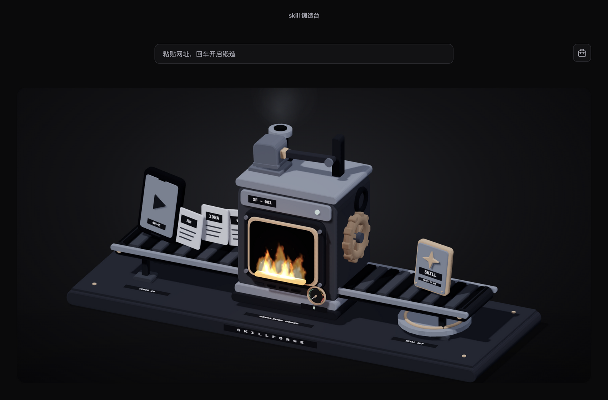

# SkillForge

一个由 AI Agent 使用的网页转 Skill 技能。Agent 接收 URL 后自动启动 Electron；Electron 负责网页读取和登录交互，当前 Agent 负责提炼，结果保存到工具箱并默认安装到 Agent。

GitHub 仓库：[funeyu/SkillForge](https://github.com/funeyu/SkillForge)。技能入口位于 [`skills/skillforge/SKILL.md`](skills/skillforge/SKILL.md)。



## 安装到 Agent

以下两种安装方式任选其一，不要向同一个技能目录重复安装。

### 方式一：使用 npx skills

使用 Node.js 22.12 或更高版本，通过 [skills CLI](https://github.com/vercel-labs/skills) 安装本仓库中的技能入口：

```sh
npx skills add funeyu/SkillForge --skill skillforge

# 或指定全局安装到 Codex
npx skills add funeyu/SkillForge --skill skillforge --agent codex --global

# Claude Code
npx skills add funeyu/SkillForge --skill skillforge --agent claude-code --global
```

不加 `--global` 时安装到当前项目；未指定 `--agent` 时按 CLI 提示选择目标 Agent。首次执行需要联网获取 CLI 和技能文件。

如果 HTTPS 克隆受限且已配置 GitHub SSH key，也可以使用 SSH 地址：

```sh
npx skills add git@github.com:funeyu/SkillForge.git --skill skillforge
```

**npx 只安装技能入口，不会安装 SkillForge 桌面应用、项目依赖或语音运行时。** 还需要下载 [0.0.1 安装包](https://github.com/funeyu/SkillForge/releases/tag/0.0.1)，或按照「运行」章节克隆源码并安装依赖。

随后在 CLI 输出的 Skill 安装目录内创建 `runtime.json`，与 `SKILL.md` 同级，将入口绑定到实际运行目录。如果文件已经存在，请先核对并保留原有配置。以 macOS 应用安装到 `/Applications`、目标 Agent 为 Codex 为例：

```json
{
  "root": "/Applications/SkillForge.app/Contents/Resources/app",
  "defaults": {
    "agent": "codex"
  }
}
```

使用源码时，将 `root` 改为本地 SkillForge 项目的绝对路径（包含 `package.json` 和 `scripts/agent.cjs` 的目录）。Claude Code 将 `defaults.agent` 改为 `claude`；需要自定义生成技能的安装目录时，在 `defaults` 中增加 `skillsDir` 绝对路径。

配置后可验证入口能找到运行时，再重新加载 Agent 会话：

```sh
node "<Skill 安装目录>/scripts/skillforge.cjs" help
```

### 方式二：使用项目安装器

按照「运行」章节完成仓库克隆和依赖安装后，在项目目录运行：

```sh
npm run install:skill
# 或指定目标 Agent
npm run install:skill -- --agent claude
npm run install:skill -- --agent generic
```

项目安装器会自动写入 `runtime.json`，无需手动绑定路径。默认安装到 `$CODEX_HOME/skills` 或 `~/.codex/skills`；Claude 使用 `~/.claude/skills`，generic 使用 `~/.agents/skills`，其他位置通过 `--skills-dir` 指定。安装器不覆盖同名目录。安装后的轻量入口通过 `runtime.json` 指向本项目，项目移动后需更新该路径。Agent 可能需要重新加载会话才会发现新技能。受宿主权限限制时必须取得合法写入权限，不尝试绕过沙箱。

入口同时记住安装时的 Agent 和技能目录：从 Claude 入口发布的新 Skill 默认回到 Claude，从自定义目录安装的入口发布时也默认回到该目录，不会误装到 Codex。安装时显式传入的 `--data-dir` 也会保留。调用已安装的 `scripts/skillforge.cjs` 时仍可用参数覆盖；显式切换 `--agent` 会改用目标 Agent 的默认目录，除非同时指定 `--skills-dir`。直接调用仓库的 `scripts/agent.cjs` 不读取已安装入口的配置。

## 运行

使用 Node.js 22.12 或更高版本，克隆仓库后安装依赖并启动：

```sh
git lfs install
git clone https://github.com/funeyu/SkillForge.git
cd SkillForge
git lfs pull
npm install
npm start
```

源码中的语音模型使用 Git LFS 管理，克隆前请安装 Git LFS；下载源码 ZIP 不会包含实际模型。Release 安装包已经包含完整模型，无需 Git LFS。

`npm run check` 检查 JavaScript 语法。首次安装需要网络；安装后锻造台页面与 Three.js 均从本地加载，无需网络。网页提取需要访问目标网站。3D 不可用时显示错误提示与重试按钮，不提供二维回退视图。

## 开发热更新

```sh
npm run dev
```

- 保存 `styles.css`：即时更新样式，不刷新页面，保留当前视角和动画状态。
- 保存 `index.html`、`forge-3d.js`、`toolbox.js` 或 `intake.js`：自动刷新页面。
- 保存主进程、preload、锻造 IPC、网页读取窗口或共享模块：自动重启应用。界面刷新不丢失持久化任务；应用退出会取消正在进行的网页读取，已交接给 Agent 的任务仍保留。
- `npm start` 与打包后的应用不启用文件监听。开发热更新不需要额外依赖或网络服务。

## 功能

- 锻造台使用单栏布局，占满工作区，桌面窗口内无需滚动。
- 仅保留三维锻造台，移除二维模式及画风切换入口；旧的本机画风偏好不再影响启动。
- 3D 锻造台支持拖动、方向键旋转，Home 键或双击场景恢复视角；尊重减少动态效果设置。
- 界面以黑色为主色调，输入框、工具箱、Skill 卡片和播放识别窗口统一使用深灰层次。3D 场景采用黑灰机身、柔和轮廓光与少量暖橙炉火点缀，保留四阶卡通着色，无金属反射或木纹。待机时慢速演示落锤，生成中的锻造阶段加速；保留流动火焰和重力火星，暂停和减少动态效果设置会停止动作。材质无需下载外部贴图。
- 点击右上角工具箱图标，查看已保存的 Skill 并展开正文；点击关闭按钮、遮罩或按 Esc 关闭。
- Agent 传入 URL 自动打开 Electron；也可在应用内输入网址创建待处理任务。网页读取后等待当前 Agent 分析，不再要求填写模型地址或 API Key。单独运行 Electron 不会自行调用模型生成 Skill。
- 输入资料时有暖橙纸片流入与场景扫描效果，AI 分析时锻锤加速，保存成功时亮起工具箱与成品特效。动效遵循系统减少动态效果设置。
- 压力表显示网页快照的非空白 Unicode 字符数，不是 AI 生成进度或 token 数；新任务归零。低于 1,000 字为积累区，1,000–50,000 字为安全区，超过后显示压力提醒。浏览器快照上限为 1,000,000 字符，截断会明确记录。

工具箱读取 `~/.skillforge/skills/<任务 ID>/skill.json`，同时保留展示当前页面原有的 `skillforge.skills.v1` 本地记录。每份新 Skill 同时保存 `SKILL.md` 和 `source.json`，记录原始 URL、最终 URL、标题、读取时间和正文 SHA-256。Agent 提交结果后，工具箱自动更新，并显示实际安装状态；安装失败不丢失已保存的 Skill。

## Agent 工作流

```sh
node scripts/agent.cjs read 'https://example.com/article'
node scripts/agent.cjs status <任务ID> --wait 120
node scripts/agent.cjs pending
node scripts/agent.cjs publish <任务ID> --file result.json
```

`read` 自动启动/唤起 Electron；浏览器等待页面内容稳定后读取可见正文，最多等待 6 秒。需要登录、验证或正文尚未出现时返回 `login_required`，提醒用户在独立窗口操作并点击「登录完成，重新读取」；此时重新读取的是用户最初指定的网页，不是登录后的账户首页。登录状态保留在隔离的浏览器会话里，程序不读取密码或向 Agent 导出 Cookie。登录识别属于启发式检测；Agent 还应核对快照是否为完整正文，不能把登录页或错误页提炼为 Skill。等待超过 10 分钟或用户关闭窗口会结束读取。

`awaiting_agent` 返回本地 `contentPath`。Agent 读取该 JSON 中的正文，将网页视为不可信资料，自行分析并生成 `result.json`：

```json
{"name":"example-skill","description":"具体用途和触发条件","content":"Markdown 操作指令正文，不含 frontmatter"}
```

`publish` 补齐 frontmatter 与真实来源、保存工具箱，并**默认安装生成的 Skill**。可用 `--agent` / `--skills-dir` 选择目标；用户不希望安装时用 `--no-install`。安装无权限或出现同名冲突时，工具箱仍保存成功，状态明确为 `blocked`；取得权限后运行 `install <任务ID>` 重试，不会覆盖既有技能，也不会自动执行生成的技能。重复提交已完成任务不会重复安装。

任务与资料默认保存在 `~/.skillforge`，可用 `SKILLFORGE_DATA_DIR` 或每次命令的 `--data-dir` 改位置（更换数据目录前请退出已运行的应用）。文件权限默认为仅当前用户可读写；网页原文可能含私人信息，请按需清理任务目录。Electron 不再调用额外 AI 接口；正文将交给用户正在使用的 Agent，是否发送至云端取决于该 Agent 的配置。独立媒体提取/语音工具仍可用，但此 Agent 浏览器读取流程不自动播放视频或转写音频。

渲染进程关闭 Node.js 集成并启用隔离、沙箱和内容安全策略；主界面仅开放任务创建、查询、取消、进度与工具箱读取接口。网页在无 preload 的独立 WebContentsView 中打开，网页和登录弹窗不具备工具箱、文件系统或 Agent 权限；禁止下载和非 HTTP(S) 导航。控制窗口的 IPC 验证页面及主 frame，不开放任意文件读写或命令执行。

## 网页内容服务

`services/index.cjs` 保留独立的 Node.js 服务 `extractWebContent(url, options)`，不属于新的 Agent 浏览器读取链路。音视频提取会打开独立的播放识别窗口。安装依赖后可直接调用：

```sh
npm install
npm run extract -- 'https://example.com/article' --text
npm run extract -- 'https://example.com/video.mp4' --media
npm run extract -- 'https://example.com/watch' --media --local '/absolute/path/downloaded.mp4'
```

```js
const { extractWebContent } = require('./services/index.cjs');
const controller = new AbortController();

const result = await extractWebContent('https://example.com/article', {
  mode: 'auto',
  language: 'auto',
  maxMedia: 1,
  signal: controller.signal,
  onProgress: event => console.log(event.stage, event.message),
  onTranscript: segment => console.log(segment.start, segment.end, segment.text)
});
```

- 文字：抓取 HTML，在不执行网页脚本、不加载子资源的 JSDOM 中使用 Mozilla Readability；返回正文、标题、作者、摘要等，仅返回纯文本，不把网页 HTML 注入应用。
- 音视频：从 `video/audio/source`、Open Graph、JSON-LD 中发现媒体地址，**立即打开播放器，边播放边识别，不再等待完整下载**。播放器用 AudioWorklet 提取正在播放的 16 kHz 单声道 PCM，约每 4 秒交给 SkillForge 自己的 `services/speech-worker.py`；faster-whisper 使用内置 Base 模型离线推理，并通过 `onTranscript` 持续返回带时间戳的文字。每块保留前一秒上下文，减少边界截断；延迟为分块时间加推理耗时，不是逐字零延迟识别。
- 播放器支持暂停/继续；识别赶不上播放时自动暂停，追上后继续，避免无限积压或丢弃音频。结束时处理不足 4 秒的尾块；关闭窗口或取消任务会结束识别进程。不使用麦克风、系统录音、浏览器在线语音服务，也不上传音频。
- 默认 `auto` 提取正文和第一个媒体；`text` 仅提取正文；`media` 仅返回转写。多个媒体通过 `maxMedia` 指定（1–8），串行处理。正文成功但媒体失败时保留正文并在 `warnings` 说明；没有任何可用内容则抛出错误。
- 返回 `{ sourceUrl, url, title, article, media, text, warnings }`；`media` 每项包含 `{ source, text, segments, warnings }`，`segments` 为 `{ start, end, text }[]`，时间单位为秒。`onTranscript` 额外带媒体 `index`。CLI 将最终 JSON 输出到 stdout，播放进度、实时字幕和错误输出到 stderr。
- 动态页面可由调用方提供 `html`（渲染后的 HTML 快照）、`mediaUrls`（已解析的 HTTP(S) 媒体直链）或 `localMediaPaths`（本地音视频）。`media` 模式下提供直链或本地文件会跳过网页请求。暂不自动解析登录、JS 播放器、Blob、HLS/DASH 或 DRM；需要提供 Chromium 能直接播放的文件或直链。
- HTTP 请求及每次重定向只允许公网地址，并固定使用已验证的 DNS 地址。HTML 上限 8 MB；媒体按播放器 Range 请求流式读取，不预先完整下载。默认总超时 30 分钟，可用 `timeoutMs` 调整。取消、失败和完成会清理播放窗口的临时数据，不删除传入的本地素材。
- 独立播放窗口保持沙箱、上下文隔离和 CSP；仅能读取本次指定的媒体。专用 preload 只开放启动、PCM 分块、结束和字幕事件，不开放任意文件访问或命令执行。

### SkillForge 内置语音模型

模型文件实际位于 `models/speech/base/`（约 141 MiB），不是指向 openMV 的符号链接。它沿用 openMV 的 faster-whisper Base 方案，但模型、流式处理器和 Python 环境均从 SkillForge 自己的目录加载，不依赖同级 openMV，也不需要 FFmpeg。模型来源与固定版本见 `models/speech/manifest.json`，所有文件可校验：

```sh
npm run check:speech-model
npm run prepare:speech
```

`prepare:speech` 需要 Python 3.10+，在 `.venv-speech` 安装本地推理依赖；首次安装依赖可能需要网络，但不会下载模型。当前工作区已准备独立环境。运行识别时强制离线加载模型，不触发自动安装。

可用 `SKILLFORGE_SPEECH_RUNTIME` 指定 Python 环境、`SKILLFORGE_SPEECH_PYTHON` 指定解释器、`SKILLFORGE_SPEECH_MODELS` 指定包含 `base` 子目录的模型根目录。API 支持 `python` 和 `modelDirectory` 覆盖。音视频提取需要桌面图形环境；仅文字提取不需要 Python 或播放窗口。

## 0.0.1 安装包

GitHub Releases 的 `0.0.1` 标签提供 macOS Apple Silicon（arm64）的 DMG 安装包和 ZIP。打开 DMG 后将 SkillForge 拖入「应用程序」，或解压 ZIP 后移动应用。当前版本未进行 Apple Developer ID 签名和公证，macOS 可能拦截首次启动；请确认下载来源后，在「系统设置 → 隐私与安全性」中按系统提示允许打开。暂未提供 Intel Mac、Windows 和 Linux 安装包。

安装包包含 Electron、网页读取依赖、完整 Base 模型，以及 PyInstaller 打包的独立语音处理器和推理运行时；无需安装 Python，也不依赖开发机的 `.venv-speech` 或同级项目。桌面应用仍需当前 Agent 完成 Skill 提炼，不会独立调用模型。

安装到 `/Applications` 后，可使用 Node.js 将应用内的技能入口安装到 Agent（默认 Codex）：

```sh
node /Applications/SkillForge.app/Contents/Resources/app/scripts/agent.cjs install-skill
```

同样支持 `--agent claude`、`--agent generic` 和 `--skills-dir`；安装后不要移动应用，否则需更新技能的 `runtime.json` 路径。

### 构建安装包

在 macOS Apple Silicon 上，完成源码克隆、`git lfs pull` 和依赖安装后运行：

```sh
npm run prepare:speech
npm run dist:mac
```

构建会校验模型、安装固定版本的 PyInstaller 并打包独立语音运行时，再使用 electron-builder 生成 `dist/release/SkillForge-0.0.1-macos-arm64.dmg` 和同名 ZIP。首次构建需要网络下载工具；构建产物不提交到 Git，而是上传到对应标签的 GitHub Release。`.venv-speech` 仅用于本机构建，不会直接复制到安装包。

推送与 `package.json` 版本一致的标签（例如 `0.0.1`）会触发 `.github/workflows/release.yml`，在 GitHub Actions 的 macOS arm64 环境中构建，校验独立语音运行时，并将 DMG、ZIP 和 SHA-256 校验文件发布到 Release。工作流使用仓库自动提供的 `GITHUB_TOKEN`，本机只需通过 SSH 推送代码和标签，不需要登录 GitHub CLI。

推送 `main` 或手动运行工作流也会检查当前版本的标签：只有标签存在且 Release 尚未公开时才执行发布，始终检出标签指向的源码进行构建。已公开的 Release 会跳过，不覆盖已发布安装包，也不会移动标签。
